# Tactica

**Gioco tattico fantasy a turni, in pixel-art, per giocare da soli, in cooperativa o in competizione su un server proprio.**


[](LICENSE)


Tactica è un gioco originale ispirato ai classici tattici a turni delle console portatili. Si gioca su mappe isometriche con altezze, generate da un seed e ruotabili in 3D. Ogni battaglia ha i suoi **Statuti**, regole estratte a sorte: chi le infrange viene sospeso e poi espulso dal campo. Le unità crescono di livello, cambiano classe e imparano abilità dall'equipaggiamento, fino a padroneggiarle.

Tutto è originale: regole, storia, nomi, grafica, musica ed effetti sonori. Terreni, interfaccia, effetti e audio sono generati da script inclusi nel repository. Personaggi e icone degli oggetti sono fatti con [PixelLab](https://pixellab.ai) e inclusi come immagini ([docs/ARTE.md](docs/ARTE.md)).

*[English summary below](#in-english).*

---

## Indice

- [Caratteristiche](#caratteristiche)
- [Immagini](#immagini)
- [Come si gioca](#come-si-gioca)
- [Architettura](#architettura)
- [Compilare ed eseguire](#compilare-ed-eseguire)
- [Server su Debian](#server-su-debian)
- [Pacchetti per i giocatori](#pacchetti-per-i-giocatori)
- [Documentazione](#documentazione)
- [Stato e prossimi passi](#stato-e-prossimi-passi)
- [Licenza](#licenza)

## Caratteristiche

### Battaglia

- **Griglia isometrica con altezze** su 5 biomi (prateria, palude, deserto, vulcano, altopiano). Le mappe sono generate da un seed: da 14×12 a 20×17 caselle, fino a 8 livelli d'altezza. Ognuna ha una forma del terreno (vallata, colle, gola, gradoni, fiume con guadi, laghi, pinnacoli) con affioramenti di roccia e boscaglia. Il generatore verifica che gli schieramenti siano collegati.
- **Ogni unità occupa la sua casella:** nessuno attraversa né alleati né nemici. Il terreno conta: la roccia protegge, la boscaglia aiuta a schivare, acqua e sabbia rallentano, la lava brucia.
- **Turni a iniziativa (CT):** la velocità decide chi agisce. Muoversi e agire costano iniziativa.
- **Danno con dislivello, fianco, spalle e terreno.** Gli elementi interagiscono con il terreno: il fulmine è più forte sull'acqua, il ghiaccio più debole sulla lava.
- **9 Statuti** estratti a sorte (per esempio «Niente cure» o «Divieto di colpire dall'alto»). Chi li viola viene sospeso e poi espulso.
- **8 status alterati:** veleno, sonno, silenzio, lentezza, radici, rapidità, egida, rigenerazione.
- **Anteprima del danno** e **suggerimento dell'IA** per ogni mossa.
- **Telecamera libera:** rotazione a 360°, inclinazione, zoom. Tre stili di resa: VGA (con retino), SVGA e nitido.

### Progressione

- **6 classi:** Avanguardia, Esploratore, Arcanista e Guaritore di base; Spadaruna e Custode da sbloccare.
- **27 abilità.** Un oggetto insegna un'abilità finché è equipaggiato; con i **punti risonanza** guadagnati in battaglia l'abilità diventa permanente.
- **Consumabili in battaglia:** ogni unità porta una borsa con 2 consumabili scelti fra 24 tipi in sei qualità: pozioni, eteri, rimedi, essenze vitali che rianimano, elisir, bombe e fiale da lancio. In più 15 pergamene che permettono a qualsiasi classe di lanciare un incantesimo una volta.
- **Bottino da conquistare sul campo:** le unità sconfitte possono lasciare un oggetto, e per prenderlo bisogna raggiungere la loro casella.
- **Oggetti generati:** più di 200.000 combinazioni con 5 rarità, 37 basi, 6 materiali e 39 affissi (veleno o gelo al colpo, armi elementali, vampirismo, resistenze, immunità, rigenerazione, +1 movimento...). In più 16 leggendari unici con nome e storia. Quattro slot di equipaggiamento: arma, armatura, copricapo, accessorio.
- **Esperienza e livelli,** roster fino a 8 unità, negozio, bottino ed economia.

### Modalità

| Modalità | Giocatori | Descrizione |
|---|---|---|
| **Campagna** | 1 | «Le Terre di Velmara»: 5 regioni, 15 tappe, una storia originale e un tutorial guidato |
| **PvE** | 1 | battaglia contro un'IA che rispecchia la tua squadra |
| **Schermaglia offline** | 1 | senza server, tutto in locale |
| **PvP classificato** | 2 | coda che abbina giocatori di ELO vicino; ELO di carriera e punteggio stagionale |
| **Missioni cooperative** | 2-6 | membri dello stesso clan contro l'IA: assedio o caccia al campione |
| **Guerre fra clan** | fino a 6 contro 6 | con ELO dei clan |
| **Tornei fra clan** | 2-16 clan | eliminazione diretta con teste di serie e premi |

### Comunità e statistiche

- **Clan** con capo, ufficiali, inviti e bonus di monete.
- **Stagioni classificate** con reset morbido, titoli (Campione, Podio, Élite) e premi.
- **Statistiche personali e globali:** vittorie, classi più usate e percentuali di vittoria, biomi, statuti rispettati e violati.
- **Replay verificabili:** seed più azioni, con hash dello stato finale.

### Server

- **Autoritativo:** il client invia solo intenzioni. Il server le valida con lo stesso motore di regole e tiene segreto il seed fino a fine partita, quindi nessuno può prevedere i tiri.
- **Persistenza** su SQLite (WAL), con migrazioni automatiche e backup periodici coerenti.
- **Sicurezza:** password Argon2id, token salvati solo come SHA-256, limiti ai tentativi di accesso e registrazione, servizio systemd isolato, TLS automatico con Caddy.
- **Partite a turni senza fretta:** nelle partite in solitaria non c'è limite di tempo. Il limite per turno vale solo quando altri giocatori aspettano, e chi si disconnette viene sostituito dall'IA.

## Immagini

| | |
|---|---|
| 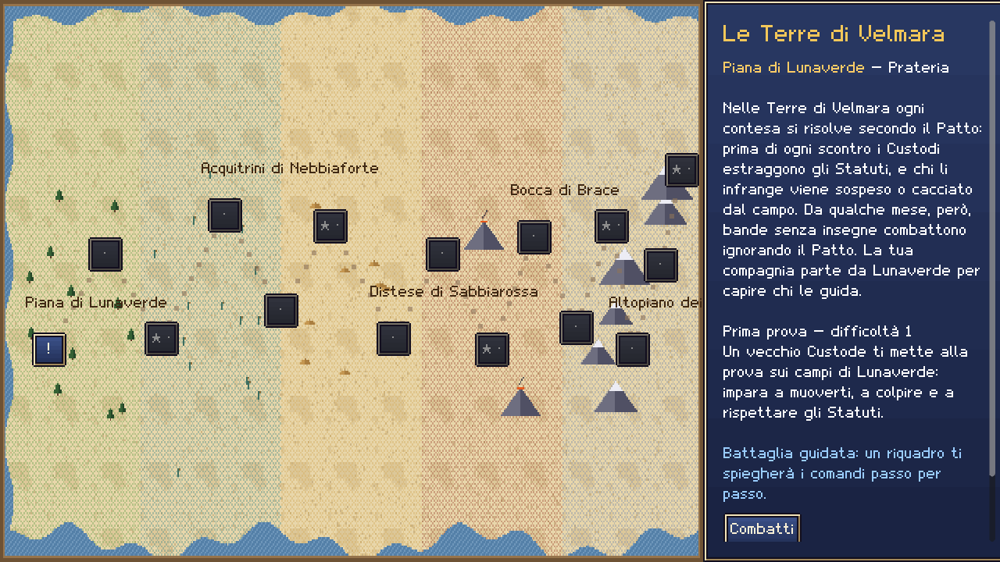 | 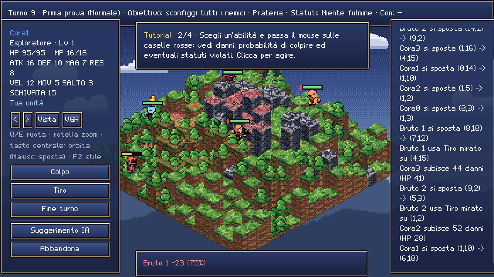 |
| *La mappa della campagna, dipinta con PixelLab* | *Il tutorial guidato* |
| 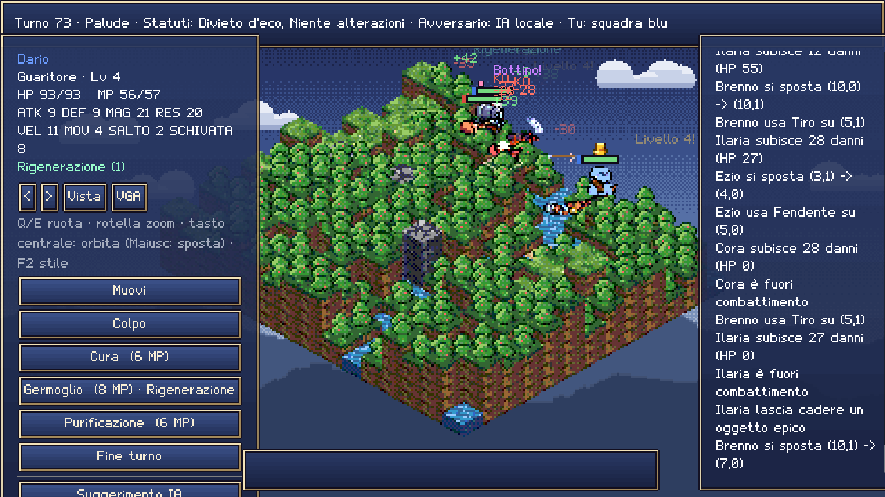 | 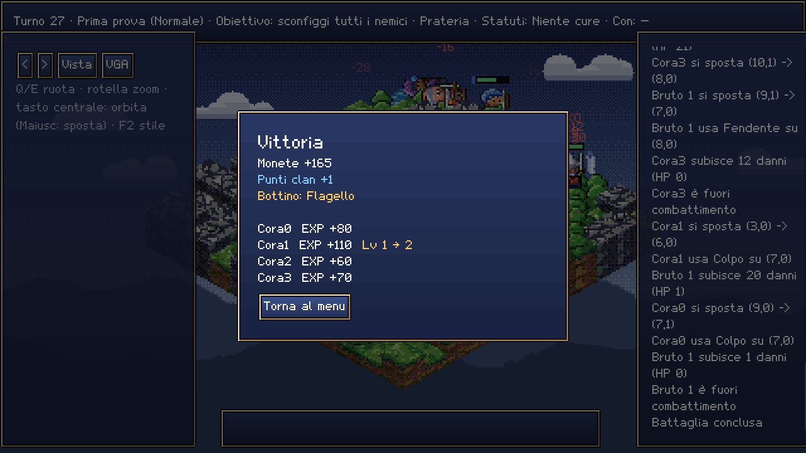 |
| *Un'unità sconfitta lascia un oggetto epico* | *Fine battaglia con il bottino raccolto* |
| 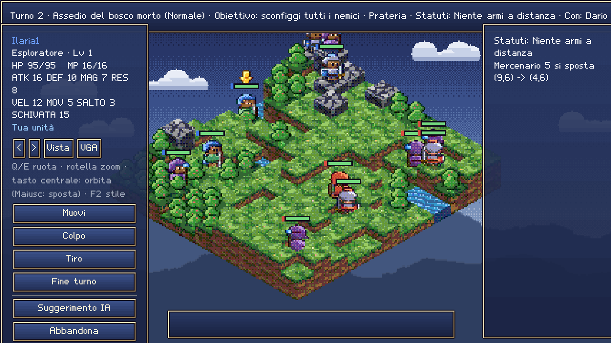 | 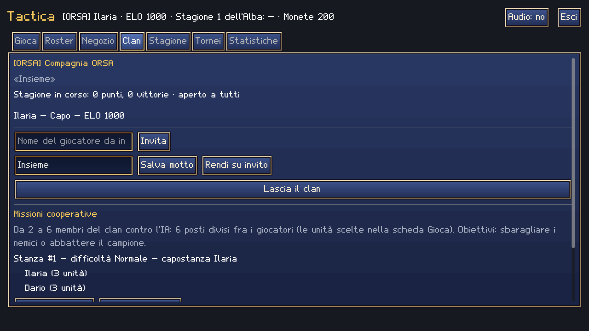 |
| *Missione cooperativa: caccia al campione* | *Stanza di missione con due giocatori* |
| 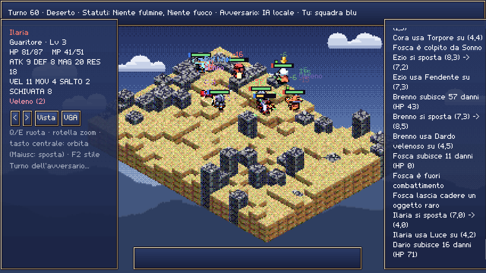 | 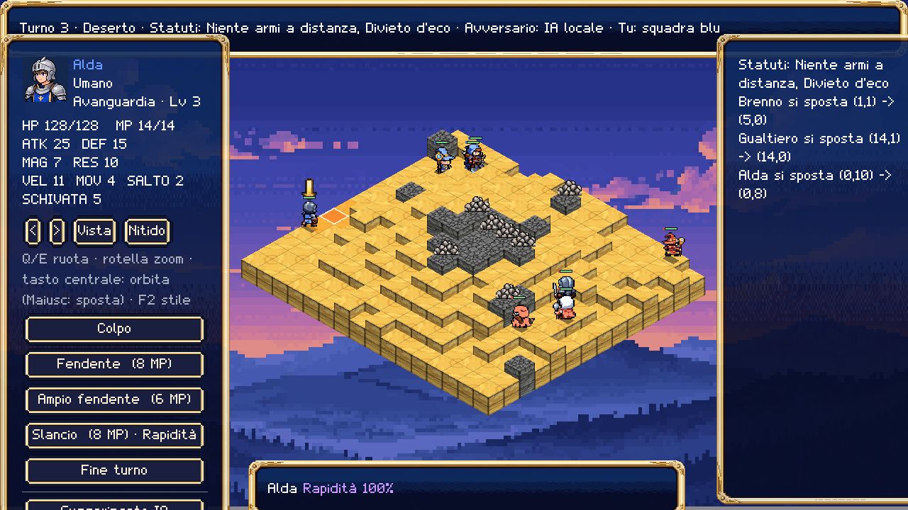 |
| *Deserto con pinnacoli di roccia* | *Anteprima di un'abilità* |
| 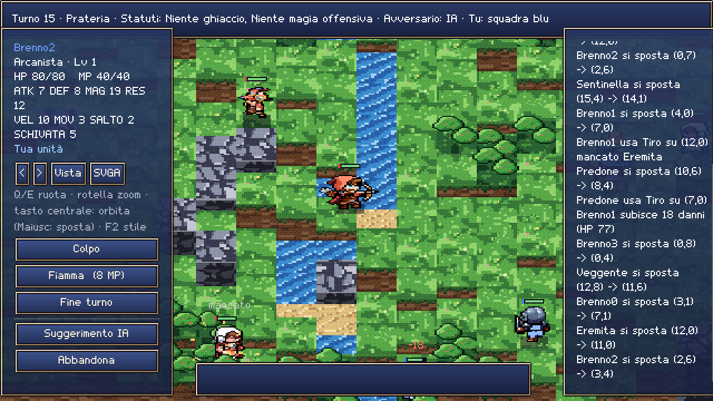 | 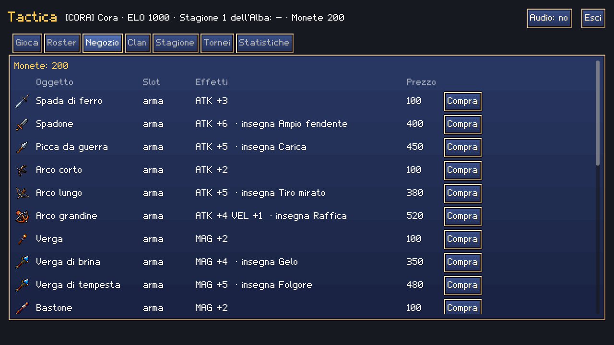 |
| *Stile SVGA* | *Negozio con le icone degli oggetti* |
|  | 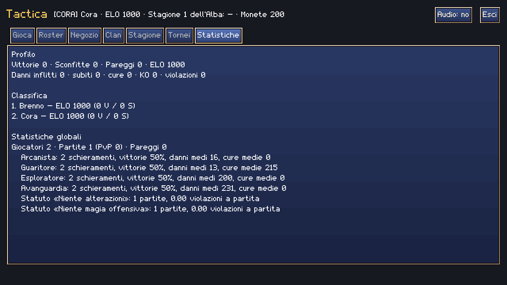 |
| *Roster ed equipaggiamento* | *Statistiche personali e globali* |

La telecamera ruota, si inclina e cambia stile di resa:

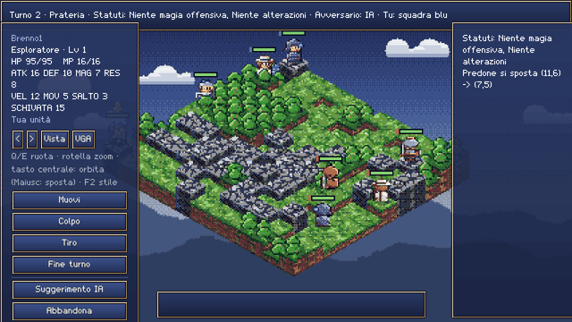

I personaggi delle sei classi, fatti con PixelLab, con i colori delle due squadre (riposo, azione, KO e camminata):

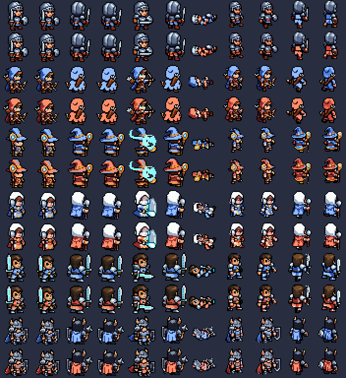

Le icone degli oggetti: 37 basi, 16 leggendari, 24 consumabili (pozioni, bombe, pergamene), gli oggetti classici e il sacchetto del bottino:

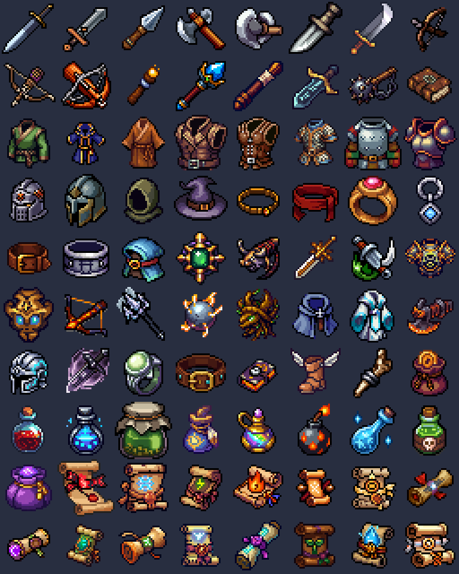

## Come si gioca

| Comando | Effetto |
|---|---|
| clic sulla mappa | sceglie la casella (movimento o bersaglio) |
| Q / E | ruota la mappa |
| rotella | zoom |
| tasto centrale | orbita; con Maiusc sposta la vista |
| F2 | cambia stile: VGA, SVGA, nitido |
| «Suggerimento IA» | mostra la mossa consigliata |

Ogni unità, nel suo turno, può muoversi e agire una volta. Prima di confermare un attacco vedi danno e probabilità di colpire. Tieni d'occhio gli Statuti in alto: violarli costa caro.

## Architettura

```
core/        motore di regole deterministico in Rust (solo interi, nessuna dipendenza obbligatoria)
cli/         demo da terminale: battaglia fra IA e verifica del replay
server/      server autoritativo: axum, WebSocket, SQLite (sqlx), Argon2id
client-ext/  estensione GDExtension in Rust che porta core/ dentro Godot
client/      client Godot 4.7 (GDScript, renderer Compatibility)
tools/       generatori di pixel-art e audio, script dei pacchetti
deploy/      servizio systemd, script d'installazione, Caddyfile
docs/        documentazione
```

**Un solo motore di regole per tutti.** Lo stesso `tactica-core` gira:

- sul server, che risolve le azioni;
- nel client, per anteprime, caselle raggiungibili, suggerimenti dell'IA e schermaglia offline;
- nei test.

Il motore è deterministico (SplitMix64 con seed, solo aritmetica intera), quindi i replay si riproducono identici e non ci sono desincronizzazioni.

```
 client Godot ──intenzioni (WebSocket)──▶ server ──▶ tactica-core ──▶ SQLite
      ▲                                     │
      └──────── eventi + stato pubblico ────┘
```

## Compilare ed eseguire

Servono **Rust** (edizione 2024), **Godot 4.7** e **Python 3** con Pillow, quest'ultimo solo per rigenerare grafica e audio.

```bash
cargo test
```

```bash
cargo run --release -p tactica-server
```

```bash
cargo build -p tactica-godot && godot --path client
```

Altri comandi utili:

```bash
cargo run --release -p tactica-cli -- 12345
```

```bash
cargo run --release -p tactica-core --example balance 1000
```

```bash
godot --path client -- --offline
```

```bash
python3 tools/pixelart/build.py
```

```bash
python3 tools/audio/synth.py
```

In ordine: una battaglia fra IA nel terminale con il seed 12345; 1000 battaglie simulate per verificare il bilanciamento; una schermaglia locale senza server; la rigenerazione di tutta la grafica; la rigenerazione di musiche ed effetti sonori.

## Server su Debian

```bash
cargo build --release -p tactica-server
```

```bash
sudo deploy/install.sh --domain gioco.esempio.it --email tua@email.it
```

Lo script installa il servizio systemd (utente effimero, dati in `/var/lib/tactica`, backup automatici) e configura Caddy con un certificato Let's Encrypt. Si può rilanciare per gli aggiornamenti; `--dry-run` mostra i comandi senza eseguirli. Dettagli e variabili di configurazione: [docs/SERVER.md](docs/SERVER.md).

## Pacchetti per i giocatori

```bash
tools/package/build.sh --server https://gioco.esempio.it
```

Crea `dist/tactica-linux.tar.gz` (circa 30 MB) e `dist/tactica-windows.zip` (circa 39 MB). Basta estrarli e avviare l'eseguibile; l'indirizzo del server è in `server.txt` e si cambia anche dalla schermata di accesso. Requisiti di compilazione: [docs/CLIENT.md](docs/CLIENT.md#pacchetti-per-i-giocatori).

## Documentazione

| Documento | Contenuto |
|---|---|
| [docs/SERVER.md](docs/SERVER.md) | API HTTP e WebSocket, progressione, clan, stagioni, cooperative, guerre, tornei, campagna, installazione |
| [docs/CLIENT.md](docs/CLIENT.md) | client Godot, schermate, controlli, pacchetti, modalità automatica per i test |
| [docs/meccaniche.md](docs/meccaniche.md) | formule di combattimento, bilanciamento, determinismo |
| [docs/ARTE.md](docs/ARTE.md) | specifiche per sostituire la grafica con pixel-art disegnata a mano |
| [tools/pixelart/README.md](tools/pixelart/README.md) | generatore della pixel-art |

## Stato e prossimi passi

Il gioco è completo e giocabile. Ci sono test end-to-end per tutte le modalità online (bot che giocano contro il server) e una modalità automatica del client per le prove e le schermate.

Prossimi passi:

1. **Prova sul campo** con altri giocatori.
2. **Scadenze per gli incontri di torneo** (oggi un incontro resta aperto finché non si gioca).
3. **PvP classificato a livelli normalizzati.**
4. **Grafica e musiche disegnate a mano:** il kit per il pixel artist è pronto ([docs/ARTE.md](docs/ARTE.md)).

## Licenza

Tactica è software libero: codice, grafica e audio sono distribuiti secondo la [GNU General Public License v3.0 o successiva](LICENSE).

I pacchetti per i giocatori includono il motore [Godot Engine](https://godotengine.org) (licenza MIT). Le dipendenze Rust hanno licenze compatibili (MIT, Apache-2.0, MPL-2.0, Zlib e simili).

---

## In English

**Tactica** is an original turn-based fantasy tactics game with pixel art, playable solo, co-op or competitively on a self-hosted server. The game text is in Italian.

- **Isometric battles** on seeded procedural maps with height, fully rotatable in 3D. Rendering is styled after the VGA and SVGA era (with Bayer dithering).
- **Statutes:** random battle rules; breaking one gets a unit suspended, then expelled.
- **Progression:** 6 classes, 27 abilities and 29 items. Abilities are learned from equipment and mastered with resonance points.
- **Modes:** single-player campaign with tutorial, PvE, offline skirmish, ELO-matched PvP, 2-6 player co-op clan missions, clan wars (up to 6v6), clan tournaments, ranked seasons.
- **Tech:**
  - deterministic rules engine in Rust (`core/`), shared by the authoritative server (axum, WebSocket, SQLite) and the Godot 4.7 client (GDExtension);
  - replays are seed plus actions;
  - Debian/systemd install script with Caddy TLS;
  - Linux and Windows client packages.
- **License:** GPL-3.0-or-later.

Quick start: `cargo test`, then `cargo run --release -p tactica-server` and `cargo build -p tactica-godot && godot --path client`.
