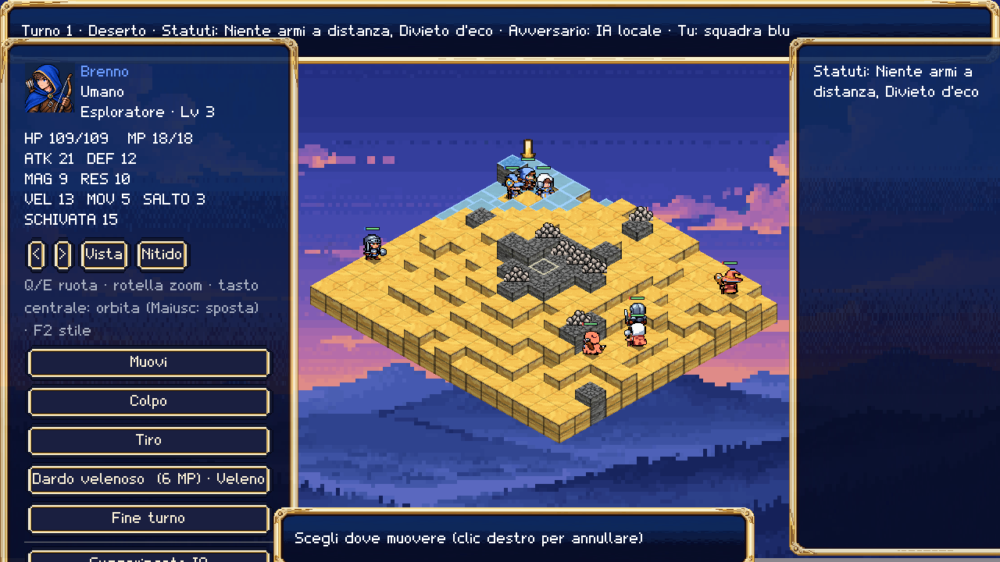

# Gioco tattico multiplayer (nome di lavoro: Tactica)



Gioco tattico fantasy originale, ispirato ai classici tattici a turni per console portatili. Contiene:

- battaglie su griglia con altezze;
- classi;
- statuti procedurali con sanzioni;
- mappe generate da seed;
- un server autoritativo con statistiche persistenti.


## Stato

- `core/`: motore di regole deterministico (solo aritmetica intera, nessuna dipendenza). Comprende:
  - mappe procedurali per 5 biomi, con verifica che gli schieramenti siano collegati;
  - 6 classi (4 base, 2 avanzate da sbloccare);
  - 27 abilità;
  - 29 oggetti che danno bonus e insegnano abilità, padroneggiabili con i punti risonanza;
  - turni a CT;
  - danno con altezza, lato d'attacco e terreno;
  - 9 statuti con sospensione ed espulsione;
  - 8 status alterati (veleno, sonno, silenzio, lentezza, radici, rapidità, egida, rigenerazione);
  - esperienza e livelli;
  - contatori statistici per unità;
  - IA golosa che rispetta gli statuti;
  - replay (seed più azioni).
- `cli/`: demo da terminale con una battaglia tra IA e la verifica del replay.
- `server/`: server autoritativo (axum, WebSocket, SQLite WAL). Comprende:
  - account Argon2id;
  - roster persistente con esperienza, livelli, equipaggiamento e padronanze;
  - inventario, negozio e bottino;
  - partite PvE contro l'IA e PvP con ELO;
  - IA che subentra a chi si disconnette o va oltre il tempo;
  - replay verificabili;
  - statistiche personali e globali;
  - backup automatici;
  - clan con ruoli e inviti;
  - missioni cooperative di clan (da 2 a 6 giocatori contro l'IA, con caccia al campione);
  - guerre fra clan (fino a 6 contro 6) con ELO dei clan;
  - tornei fra clan a eliminazione diretta con teste di serie e premi;
  - stagioni classificate con titoli e premi.

  Dettagli in [docs/SERVER.md](docs/SERVER.md).
- `deploy/`: unit systemd isolata e Caddyfile per TLS.
- `tools/pixelart/`: generatore della pixel-art originale del client: personaggi chibi con camminata, terreni, effetti, font, mappa del mondo, kit per il pixel artist.
- `tools/audio/`: sintetizzatore chiptune delle musiche (menu, battaglia, mappa del mondo, fanfare) e degli effetti sonori.
- Campagna in singolo: «Le Terre di Velmara», con 5 regioni, 15 tappe, una storia originale e un tutorial guidato.
- `client-ext/` e `client/`: client Godot 4.7 con estensione Rust sul core. Comprende:
  - accesso;
  - roster, negozio e statistiche;
  - battaglia in 3D ruotabile con estetica VGA/SVGA, anteprime e suggerimenti;
  - clan e stagioni;
  - partite online e schermaglia offline;
  - modalità automatica per i test.

  Dettagli in [docs/CLIENT.md](docs/CLIENT.md).

## Comandi

```bash
cargo test
```

```bash
cargo run --release -p tactica-cli -- 12345
```

```bash
cargo run --release -p tactica-core --example balance 1000
```

```bash
cargo run --release -p tactica-server
```

```bash
cargo build -p tactica-godot && godot --path client
```

## Prossimi passi

1. **Matchmaking per ELO**, scadenze per gli incontri di torneo; rate limiting prima dell'apertura su Internet.
2. **Grafica definitiva** di un pixel artist (kit pronto: [docs/ARTE.md](docs/ARTE.md)).
