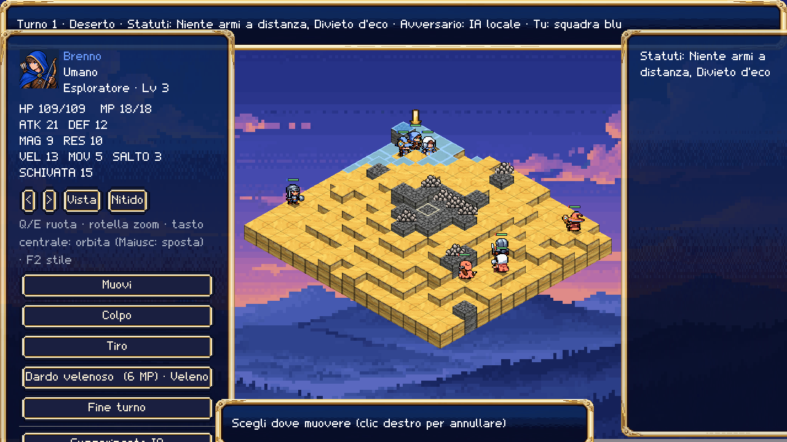
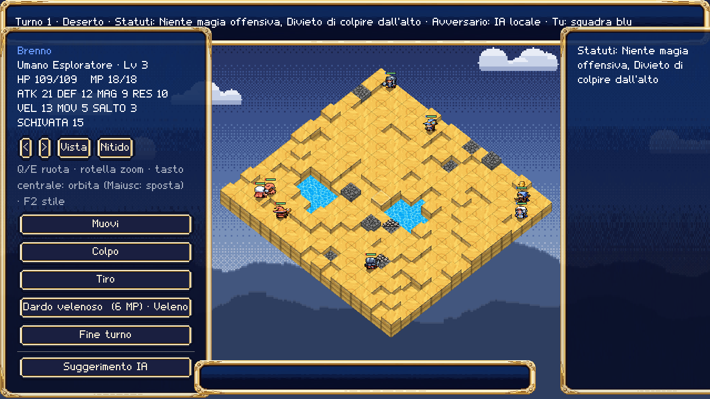
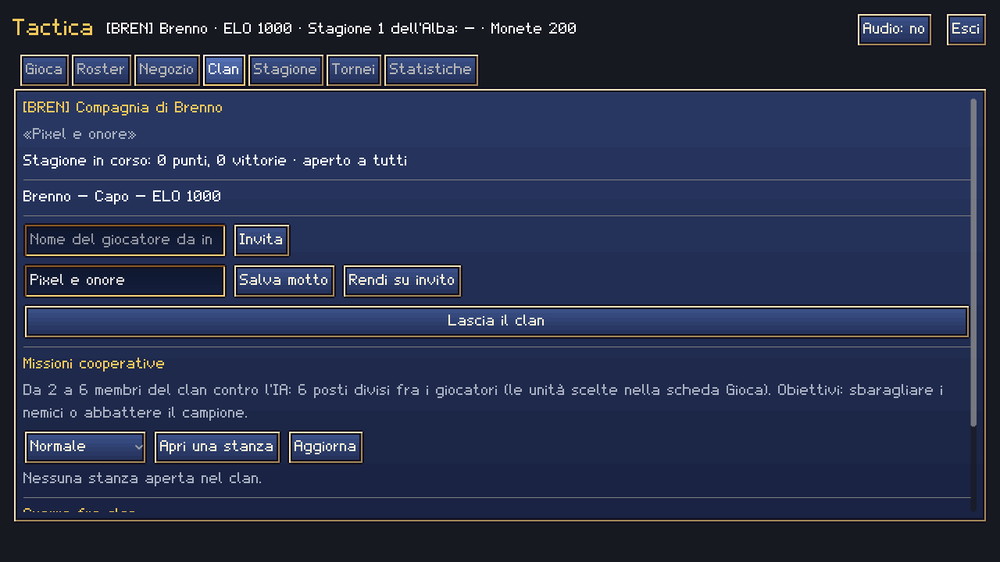

# Client Godot

Il progetto Godot 4.7 è in `client/`; l'estensione Rust (GDExtension) che porta `tactica-core` dentro Godot è in `client-ext/`.

La battaglia è in **3D ruotabile** con estetica **VGA/SVGA**:

- **Mappa:** colonne di caselle con texture pixel-art a 16×16; acqua e lava animate; cespugli e sassi come sprite.
- **Personaggi:** sprite chibi verticali. A seconda dell'angolo da cui li guardi mostrano la vista frontale o posteriore, specchiata quando serve.
- **Telecamera:** ortogonale e orbitale, con rotazione libera a 360°, inclinazione tra 20° e 70° e zoom limitato fra un primo piano e la mappa intera.
- **Resa a bassa risoluzione:**
  - **VGA:** 1/3 della finestra, circa 426×240, con 6 livelli per canale e retino di Bayer;
  - **SVGA:** 1/2 della finestra, con 10 livelli;
  - **Nitido:** senza filtro.

  L'immagine viene ingrandita senza sfocatura; il tasto F2 o il pulsante dello stile passa da uno stile all'altro.
- **Sopra la scena:** barre degli HP, colore di squadra e numeri fluttuanti, sempre leggibili.

Le texture vengono da `tools/pixelart` (vedi il suo README).






## Avvio

```bash
cargo build -p tactica-godot
```

```bash
godot --path client
```

L'estensione viene caricata da `target/debug/libtactica_godot.so`, oppure da `target/release/` nelle build di rilascio; i percorsi sono in `client/tactica.gdextension`. Va ricompilata dopo ogni modifica al core.

Per aprire il progetto nell'editor:

```bash
godot --path client --editor
```

## Schermate

- **Accesso:** indirizzo del server, accesso o registrazione, schermaglia offline contro l'IA senza server.
- **Menu:**
  - **Gioca:** scelta di fino a 4 unità, coda PvE o PvP, annullamento della coda.
  - **Roster:** reclutamento; per ogni unità equipaggiamento per slot, abilità usabili, progressi di risonanza, cambio classe con i requisiti mancanti, congedo.
  - **Negozio:** acquisti e vendite.
  - **Clan:** fondazione, adesione, inviti ricevuti, membri e ruoli, inviti, espulsioni, motto, apertura, uscita. Da qui si gestiscono anche le **missioni cooperative**: apri una stanza scegliendo la difficoltà, vedi ed entri nelle stanze del clan, avvii la missione se sei il capostanza. C'è anche la sezione **Guerre fra clan**:
    - ELO e record del clan;
    - dichiarazione di guerra a un altro clan (capo o ufficiali);
    - guerre in arrivo da accettare o rifiutare, e guerre da annullare;
    - schieramento con i "pronti" dei comandanti;
    - storico con l'ELO del clan prima e dopo.
  - **Stagione:** tempo rimanente, premi, il tuo punteggio, classifiche di giocatori e clan, stagioni passate.
  - **Statistiche:** profilo, classifica, statistiche globali.
- **Battaglia:**
  - **Mappa:** isometrica, scalata alla finestra.
  - **Pannello sinistro:** scheda dell'unità attiva (o di quella sotto il mouse) e azioni: muovi, abilità con costo in MP, fine turno con scelta della direzione, suggerimento dell'IA, abbandono.
  - **Anteprima al passaggio sul bersaglio:** area d'effetto, danni e probabilità di colpire per ogni unità, avviso se l'azione viola uno statuto.
  - **Registro degli eventi** in italiano, con numeri fluttuanti per danni, cure, mancati, sanzioni e livelli.
  - **Status alterati:** icone colorate sopra la barra degli HP, elenco con i turni rimanenti nella scheda dell'unità, scritte fluttuanti (status applicato, "resiste", "Zzz"), probabilità di status nell'anteprima dell'attacco.
  - **Fine partita:** risultato, ELO, punteggio stagionale, monete (con il bonus del clan), punti clan, bottino, esperienza e punti risonanza per unità.

Comandi:

- clic sinistro per scegliere la casella, clic destro per annullare;
- Q/E o i pulsanti ⟲/⟳ ruotano di 45°; R o "Vista" riporta la vista iniziale;
- rotella per lo zoom;
- tasto centrale trascinato: orbita e inclinazione (con Maiusc sposta la vista);
- F2 cambia stile grafico.

## Divisione dei compiti

- **Partite online:** il client invia solo intenzioni e riceve eventi più lo snapshot pubblico. Con `TacticaEngine.from_snapshot` calcola in locale caselle raggiungibili, bersagli, anteprime e suggerimenti; la risoluzione resta al server.
- **Schermaglia offline:** `TacticaEngine.new_local` crea una battaglia completa.
- **Scambio dati:** i dati strutturati passano come testo JSON. Snapshot ed eventi vengono letti dal testo grezzo del messaggio (`set_snapshot_from_message`, `describe_message_events`), così i numeri non passano dalle conversioni float di GDScript.

## Modalità automatica (test e dimostrazioni)

Argomenti dopo `--`:

| Argomento | Effetto |
|---|---|
| `--autoplay` | gioca da solo con i suggerimenti dell'IA |
| `--offline` | schermaglia locale |
| `--server=URL` | server da usare |
| `--user=… --pass=…` | credenziali; se l'account non esiste viene registrato |
| `--mode=pve`, `--mode=pvp` oppure `--mode=coop` | modalità della partita |
| `--role=host` oppure `--role=guest`, `--clan=SIGLA` | solo in cooperativa: chi fonda il clan e apre la stanza, e chi entra |
| `--mode=war --role=host` oppure `--role=guest`, `--clan=SIGLA --enemy=SIGLA` | guerra fra clan: ognuno fonda il proprio clan; l'host dichiara guerra e il guest accetta |
| `--shots=CARTELLA` | salva schermate dei momenti salienti |

In modalità online, se il roster è vuoto il client:

1. recluta una squadra;
2. compra e equipaggia la Verga di brina;
3. fotografa le schede del menu;
4. gioca;
5. mostra le ricompense e chiude.

Esempi:

```bash
godot --path client -- --autoplay --offline --shots=/tmp/shots
```

```bash
godot --path client -- --autoplay --server=http://127.0.0.1:7777 --user=prova --pass=password-lunga
```

Per una prova senza finestra (niente schermate):

```bash
godot --headless --path client -- --autoplay --offline
```
