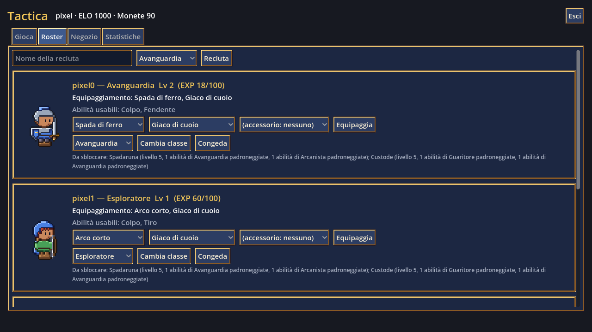
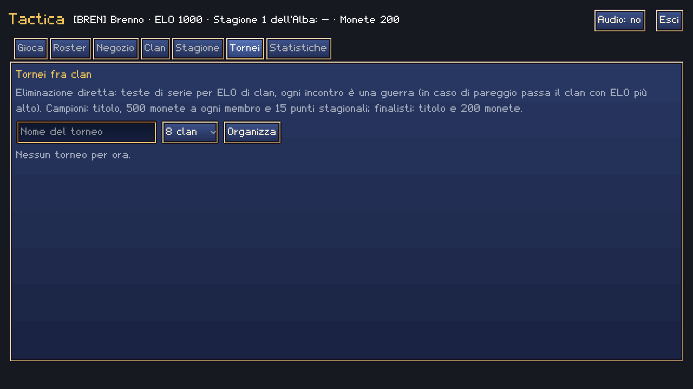

# Client Godot

Il progetto Godot 4.7 è in `client/`; l'estensione Rust (GDExtension) che porta `tactica-core` dentro Godot è in `client-ext/`.

La battaglia è in **3D ruotabile** con estetica **VGA/SVGA**:

- **Mappa:** colonne di caselle con texture pixel-art a 32×32 (PixelLab), con mipmap per le viste lontane e un filo di 1 pixel fra le sommità che rende leggibile la griglia; acqua e lava animate; cespugli e sassi come sprite.
- **Personaggi:** sprite chibi verticali. A seconda dell'angolo da cui li guardi mostrano la vista frontale o posteriore, specchiata quando serve.
- **Telecamera:** ortogonale e orbitale, con inclinazione tra 20° e 70° e zoom limitato fra un primo piano e la mappa intera. La rotazione si ferma sempre su una delle quattro viste isometriche (45°, 135°, 225°, 315°): anche dopo l'orbita col tasto centrale la vista torna alla diagonale più vicina, così la mappa non appare mai "dritta" e deformata.
- **Stili di resa** (F2 o il pulsante dello stile; la scelta resta salvata):
  - **Nitido** (predefinito): risoluzione piena, la pixel-art dei terreni si vede per intero;
  - **Pixel:** 1/2 della finestra, pixel più grossi, senza filtro;
  - **SVGA:** 1/2 della finestra, con 10 livelli per canale e retino;
  - **VGA:** 1/3 della finestra, con 6 livelli per canale e retino di Bayer.

  Negli stili ridotti l'immagine viene ingrandita senza sfocatura.
- **Caselle evidenziate:** all'inizio del proprio turno compaiono subito, in azzurro, le caselle raggiungibili. Scegliendo un'abilità tutta la sua portata si colora di rosso (pieno dove c'è un'unità, tenue altrove); per gli oggetti in verde. Le caselle pulsano e hanno un bordo chiaro, visibili su ogni terreno.
- **Sopra la scena:** barre degli HP, colore di squadra e numeri fluttuanti, sempre leggibili.

Le texture vengono da `tools/pixelart` (vedi il suo README). Tutto è pixel-art originale:

- **Font:** bitmap disegnato a pixel (Tactica Pixel), ingrandito solo per multipli interi.
- **Finestre:** cornici con angoli arrotondati e bordo crema.
- **Terreni:** lastre e placche irregolari, erba che ricade sui fianchi, ciuffi e cespugli.
- **Fondale:** cielo a bande con nuvole e colline.
- **Sprite:** ombreggiatura di volume con passaggi a retino e contorni morbidi sul lato in luce.






## Campagna, audio ed effetti

- **Campagna:** «Le Terre di Velmara», dal pulsante nella scheda Gioca. Ha una mappa del mondo su pergamena con 5 regioni e 15 tappe; l'ultima tappa di ogni regione è la caccia a un campione. Si sblocca una tappa alla volta e la storia si legge nel pannello laterale. La prima tappa è un tutorial: un riquadro spiega movimento, abilità e anteprime, fine turno e direzione, statuti.
- **Movimento:** le unità camminano casella per casella lungo il percorso, con i passi animati e un piccolo salto nei cambi di altezza.
- **Effetti delle abilità:** fendenti, frecce in volo, fiamme, ghiaccio, fulmini, luce, cure, potenziamenti e alterazioni, veleno, risucchio.
- **Audio:** tutto originale e sintetizzato in codice, in stile anni '90: FM a operatori come la Sound Blaster (OPL3) e strumenti orchestrali con riverbero come i moduli MIDI tipo MT-32.
  - **Musiche:**
    - menu (re maggiore, flauto e corno su archi e arpa);
    - mappa del mondo (6/8, flauto e pizzicati);
    - battaglia (la minore, ottoni e lead FM);
    - battaglia fra giocatori e clan (mi minore, FM marcata);
    - campione (re minore, coro, organo e timpani);
    - bottega (fa maggiore, swing; per Negozio e Bottega);
    - fanfare di vittoria e sconfitta.

    Le musiche sono in loop senza giunture e si alternano con una breve dissolvenza.
  - **Effetti (66):**
    - **armi:** taglio, colpo pesante, affondo, contundente, freccia, lancio;
    - **colpi:** normale, fatale, mancato, parata, KO;
    - **elementi:** fuoco, ghiaccio, fulmine, luce, risucchio, incantesimo;
    - **status:** un suono per ognuno dei 10;
    - **oggetti:** pozione, bomba, pergamena, rianimazione, MP;
    - **bottino:** caduta e raccolta;
    - **statuti:** gong della violazione, sospensione, espulsione;
    - **progressi:** livello, padronanza, inizio del proprio turno;
    - **passi:** diversi per erba, roccia, sabbia, acqua, boscaglia;
    - **lava:** bruciatura;
    - **interfaccia:** clic, passaggio del mouse, conferma, annulla, errore, schede;
    - **gestione:** equipaggiare, togliere, comprare, vendere, forgiare, incantare, smantellare, alchimia, recluta, cambio di classe.

    Taglio, colpi e passi variano un po' di intonazione a ogni uso.

  Il pulsante «Audio» nel menu attiva o disattiva tutto; con `--mute` il gioco parte senza audio.
- **Turni:** il gioco è a turni. Nelle partite in solitaria non c'è limite di tempo; il limite per turno vale solo quando altri giocatori aspettano.

## Avvio

```bash
cargo build -p tactica-godot
```

```bash
godot --path client
```

L'estensione viene caricata da `target/debug/libtactica_godot.so`, oppure da `target/release/` nelle build di rilascio; i percorsi sono in `client/tactica.gdextension`. Va ricompilata dopo ogni modifica al core.

Per aprire il progetto nell'editor:

```bash
godot --path client --editor
```

## Pacchetti per i giocatori

```bash
tools/package/build.sh --server https://gioco.esempio.it
```

Lo script esporta il gioco con i modelli di Godot e crea due archivi in `dist/`:

| Archivio | Dimensione | Contenuto |
|---|---|---|
| `tactica-linux.tar.gz` | circa 30 MB | `Tactica.x86_64`, `Tactica.pck`, `libtactica_godot.so` |
| `tactica-windows.zip` | circa 39 MB | `Tactica.exe`, `Tactica.pck`, `tactica_godot.dll` (Windows 10/11 a 64 bit) |

In entrambi ci sono anche `server.txt`, con l'indirizzo del server predefinito, e `LEGGIMI.txt`. Il giocatore estrae l'archivio e avvia l'eseguibile. L'indirizzo si può cambiare nella schermata di accesso, oppure per sempre in `server.txt`; `-- --server=URL` ha la precedenza su entrambi. Con `tools/package/build.sh … linux` (o `windows`) si crea un solo pacchetto.

Requisiti, già installati su questa macchina:

- **Modelli di esportazione di Godot 4.7.2** in `~/.local/share/godot/export_templates/4.7.2.stable/`. Ci sono solo quelli per Linux e Windows x86_64, presi dall'archivio ufficiale (verificato con SHA-512).
- **Per Windows, llvm-mingw** (release 20261020, verificata con SHA-256) in `~/Android/llvm-mingw`, più il target Rust `x86_64-pc-windows-gnullvm`. La DLL usa solo librerie di sistema di Windows (UCRT), quindi non servono altri file.

Il pacchetto Windows è stato provato con Wine, offline e contro un server locale.
## Schermate

- **Accesso:** indirizzo del server, accesso o registrazione, schermaglia offline contro l'IA senza server.
- **Menu:**
  - **Gioca:** scelta di fino a 4 unità, coda PvE o PvP, annullamento della coda.
  - **Roster:** reclutamento; per ogni unità equipaggiamento per slot, abilità usabili, progressi di risonanza, cambio classe con i requisiti mancanti, congedo.
  - **Negozio:** acquisti e vendite.
  - **Clan:** fondazione, adesione, inviti ricevuti, membri e ruoli, inviti, espulsioni, motto, apertura, uscita. Da qui si gestiscono anche le **missioni cooperative**: apri una stanza scegliendo la difficoltà, vedi ed entri nelle stanze del clan, avvii la missione se sei il capostanza. C'è anche la sezione **Guerre fra clan**:
    - ELO e record del clan;
    - dichiarazione di guerra a un altro clan (capo o ufficiali);
    - guerre in arrivo da accettare o rifiutare, e guerre da annullare;
    - schieramento con i "pronti" dei comandanti;
    - storico con l'ELO del clan prima e dopo.
  - **Stagione:** tempo rimanente, premi, il tuo punteggio, classifiche di giocatori e clan, stagioni passate.
  - **Tornei:** organizzazione, iscrizione, avvio; tabellone a colonne per turno con vincitori evidenziati e pulsante «Schierati» per gli incontri del proprio clan.
  - **Statistiche:** profilo, classifica, statistiche globali.
- **Battaglia:**
  - **Mappa:** isometrica, scalata alla finestra.
  - **Pannello sinistro:** scheda dell'unità attiva (o di quella sotto il mouse) e azioni: muovi, abilità con costo in MP, fine turno con scelta della direzione, suggerimento dell'IA, abbandono.
  - **Anteprima al passaggio sul bersaglio:** area d'effetto, danni e probabilità di colpire per ogni unità, avviso se l'azione viola uno statuto.
  - **Registro degli eventi** in italiano, con numeri fluttuanti per danni, cure, mancati, sanzioni e livelli.
  - **Status alterati:** icone colorate sopra la barra degli HP, elenco con i turni rimanenti nella scheda dell'unità, scritte fluttuanti (status applicato, "resiste", "Zzz"), probabilità di status nell'anteprima dell'attacco.
  - **Fine partita:** risultato, ELO, punteggio stagionale, monete (con il bonus del clan), punti clan, bottino, esperienza e punti risonanza per unità.

Comandi:

- clic sinistro per scegliere la casella, clic destro per annullare;
- Q/E o i pulsanti ⟲/⟳ ruotano di 90°, da una vista isometrica all'altra; R o "Vista" riporta la vista iniziale;
- rotella per lo zoom;
- tasto centrale trascinato: orbita e inclinazione (con Maiusc sposta la vista);
- F2 cambia stile grafico.

## Divisione dei compiti

- **Partite online:** il client invia solo intenzioni e riceve eventi più lo snapshot pubblico. Con `TacticaEngine.from_snapshot` calcola in locale caselle raggiungibili, bersagli, anteprime e suggerimenti; la risoluzione resta al server.
- **Schermaglia offline:** `TacticaEngine.new_local` crea una battaglia completa.
- **Scambio dati:** i dati strutturati passano come testo JSON. Snapshot ed eventi vengono letti dal testo grezzo del messaggio (`set_snapshot_from_message`, `describe_message_events`), così i numeri non passano dalle conversioni float di GDScript.

## Modalità automatica (test e dimostrazioni)

Argomenti dopo `--`:

| Argomento | Effetto |
|---|---|
| `--autoplay` | gioca da solo con i suggerimenti dell'IA |
| `--offline` | schermaglia locale |
| `--server=URL` | server da usare |
| `--user=… --pass=…` | credenziali; se l'account non esiste viene registrato |
| `--mode=pve`, `--mode=pvp` oppure `--mode=coop` | modalità della partita |
| `--role=host` oppure `--role=guest`, `--clan=SIGLA` | solo in cooperativa: chi fonda il clan e apre la stanza, e chi entra |
| `--mode=war --role=host` oppure `--role=guest`, `--clan=SIGLA --enemy=SIGLA` | guerra fra clan: ognuno fonda il proprio clan; l'host dichiara guerra e il guest accetta |
| `--shots=CARTELLA` | salva schermate dei momenti salienti |

In modalità online, se il roster è vuoto il client:

1. recluta una squadra;
2. compra e equipaggia la Verga di brina;
3. fotografa le schede del menu;
4. gioca;
5. mostra le ricompense e chiude.

Esempi:

```bash
godot --path client -- --autoplay --offline --shots=/tmp/shots
```

```bash
godot --path client -- --autoplay --server=http://127.0.0.1:7777 --user=prova --pass=password-lunga
```

Per una prova senza finestra (niente schermate):

```bash
godot --headless --path client -- --autoplay --offline
```
